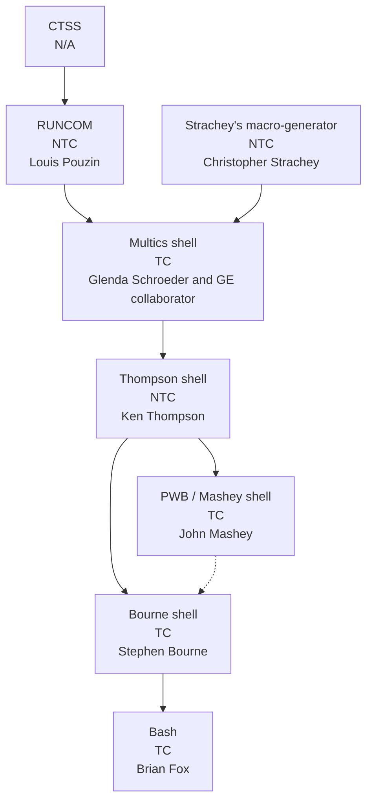

mermaid

Legend:

- TC = Turing Complete
- NTC = Not Turing Complete
- CTSS = Operating system; TC/NTC distinction does not apply.
- Solid arrow = Major inspiration.
- Dashed arrow = Minor inspiration.
